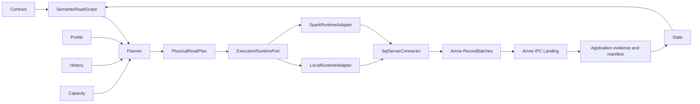

# Architecture

`src/landfall/core` owns normative contract validation, semantic models and physical planning. It imports no source, cloud or runtime SDK. `ports.py` defines source, storage, secret, telemetry, and execution runtime protocols. `adapters` implements SQL Server, local/ADLS storage, secret resolution, local execution, and Spark execution. The Spark adapter lives outside Core and invokes the existing SQL Server source path. `application/capture.py` coordinates the run and owns durable state; `cli` wires adapters.

The wheel contains Core and adapters. PySpark is an optional extra; local imports and execution do not require it. Azure SDK imports occur only when Azure adapters are selected. Local tests can import the core without a SQL connection or cloud credentials. A future source implements `SourcePort` and is registered at the CLI composition boundary; the core need not change.

The local runtime uses a bounded thread pool. The Spark runtime sends small descriptors through `DataFrame.mapInArrow`; source Arrow batches are streamed to IPC files on workers, while the driver collects result metadata only. A storage CAS lease limits each dataset to one active writer, and committed partition metrics feed the next plan. The production source protocol remains `SqlServerConnector` → `mssql-python` → Arrow. A production architecture test rejects JDBC symbols in source code. Databricks and Unity Catalog executor access are not certified.
