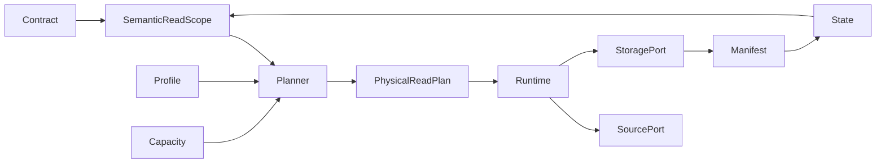

# Architecture

`src/landfall/core` owns normative contract validation, semantic models and physical planning. It imports no source, cloud or runtime SDK. `ports.py` defines source, storage, secret and telemetry protocols. `adapters` implements SQL Server, local/ADLS storage, secret resolution and local capacity. `application/capture.py` coordinates the run and is the composition boundary; `cli` wires adapters.

The wheel contains all core and adapter code. Azure SDK imports occur only when Azure adapters are selected. Local tests can import the core without a SQL connection or cloud credentials. A future source implements `SourcePort` and is registered at the CLI composition boundary; the core need not change.

Current local runtime uses a bounded thread pool. Spark and Databricks can supply another execution adapter using the same plan and wheel. They are not implemented in V1.
