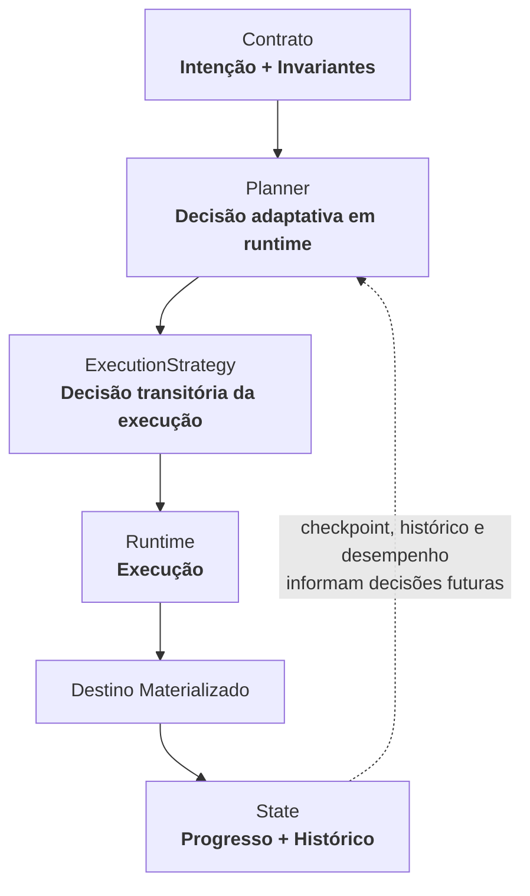

# Contrato de Ingestão
## Especificação Conceitual e Normativa — V1

---

# 1. Definição e filosofia

O **Contrato de Ingestão** é uma especificação declarativa, versionada e independente de infraestrutura que estabelece as condições sob as quais um conjunto de dados deve ser **extraído de uma origem, transportado e materializado em um destino**.

Ele representa um acordo explícito entre quem declara uma necessidade de ingestão e a plataforma responsável por executá-la.

O contrato descreve **intenção, identidade, semântica e restrições**. Ele não descreve mecanismos físicos de execução.

> **O contrato define o que deve acontecer. A plataforma decide como fazer acontecer.**

Essa separação é o princípio central do modelo.

## 1.1 Princípio fundamental

A regra usada para decidir se uma informação pertence ao contrato é:

> **O engenheiro deve declarar apenas aquilo que não pode ser inferido de maneira segura e inequívoca pelo motor de ingestão.**

O contrato deve evitar tanto:

- **subespecificação**, quando o comportamento fica ambíguo;
- **superespecificação**, quando decisões internas da plataforma passam a fazer parte da interface pública.

O objetivo é manter o contrato pequeno, estável e semanticamente forte.

## 1.2 Propriedades desejáveis

Um bom Contrato de Ingestão deve ser:

- **declarativo** — expressa o que deve acontecer;
- **determinístico** — a mesma versão possui a mesma semântica;
- **versionável** — mudanças são explícitas e rastreáveis;
- **portável** — não depende da implementação corrente;
- **minimalista** — não expõe decisões que podem ser inferidas;
- **extensível** — novas origens e capacidades podem ser adicionadas sem quebrar a semântica existente;
- **auditável** — é possível saber qual versão definiu uma execução;
- **explicável** — o comportamento resultante deve ser compreensível a partir do contrato.

Uma ingestão não deve ser definida pela tecnologia usada para executá-la. Ela deve ser definida por sua semântica.

---

# 2. Fronteira de responsabilidades

A arquitetura distingue quatro responsabilidades centrais:

> **Contrato = intenção e invariantes.**<br>
> **Planner = decisão adaptativa em runtime.**<br>
> **Runtime = execução.**<br>
> **State = progresso e evidências operacionais.**



O **Contrato** declara o comportamento esperado da ingestão.

O **Planner** combina contrato, estado, características da origem, capacidades disponíveis, histórico e restrições para decidir a melhor estratégia para a execução corrente.

A **ExecutionStrategy** é uma decisão transitória e contextual. Pode ser reutilizada ou reavaliada entre execuções, mas não faz parte do contrato.

O **Runtime** executa a estratégia preservando a semântica declarada.

O **State** mantém checkpoints, status, histórico, evidências da execução e conhecimento operacional que pode melhorar decisões futuras.

## 2.1 O que pertence ao Contrato

Pertencem ao contrato informações como:

- identidade da ingestão;
- domínio e sistema lógico produtor;
- origem a ser lida;
- campos autorizados para transporte;
- semântica de leitura (`full`, `incremental` ou `continuous`);
- semântica de posição para leituras progressivas (`SourcePosition`);
- filtros de elegibilidade;
- identidade lógica do asset de destino;
- semântica de escrita (`append` ou `replace`);
- intenção de deduplicação por fingerprint;
- objetivos operacionais;
- constraints externas que não podem ser violadas.

## 2.2 O que não pertence ao Contrato

Não pertencem ao contrato decisões ou estados como:

- número de workers;
- número de partições ou splits;
- boundaries de particionamento;
- partition key física escolhida pelo Planner;
- estratégia de paralelismo;
- concorrência efetiva;
- tamanho de batch;
- mecanismo físico de retry;
- algoritmo físico de hash;
- checkpoint atual;
- identificador da execução corrente;
- duração observada;
- tecnologia de processamento;
- tecnologia de armazenamento;
- cluster, VM, pod ou infraestrutura;
- scheduler ou DAG;
- mecanismo de secrets;
- estratégia física de execução.

A regra normativa é:

> **O contrato declara o que não pode ser inferido com segurança. O motor decide todo o restante.**

## 2.3 Estabilidade do contrato e adaptatividade

O histórico operacional pode melhorar decisões futuras sem modificar a intenção declarada.

Exemplo conceitual:

```text
Contrato permanece igual
        ↓
Execução 1
estratégia A
alto skew observado
        ↓
State / Histórico
        ↓
Execução 2
Planner reutiliza, ajusta ou substitui a estratégia
```

> **O contrato permanece estável enquanto a execução pode evoluir continuamente.**

---

# 3. Escopo conceitual

## 3.1 O que o Contrato de Ingestão é

O contrato é um artefato de **desired state** para ingestão orientada a registros.

Uma versão do contrato representa a intenção vigente para aquela ingestão e estabelece:

- quem é a ingestão;
- de onde os dados vêm;
- qual recurso lógico ou físico deve ser lido;
- quais atributos podem ser transportados;
- quais registros são elegíveis;
- como o progresso entre execuções é representado;
- como o resultado deve ser materializado;
- quais invariantes e constraints devem ser preservados.

A linguagem do contrato deve permanecer estável mesmo quando a origem, o formato físico, o runtime de execução ou o destino mudarem.

## 3.2 Modelo de dado suportado

O Contrato de Ingestão é, por definição, **record-oriented**.

Ele pode representar dados provenientes de diferentes naturezas de origem, desde que o connector consiga expor o conteúdo como um fluxo de registros canônicos.

Exemplos de workloads compatíveis:

- tabelas e views relacionais;
- documentos de bancos documentais;
- eventos de mensageria;
- respostas estruturadas de APIs;
- listas de plataformas colaborativas;
- registros decodificados de arquivos estruturados ou semiestruturados;
- coleções de objetos cujo conteúdo possa ser interpretado como registros.

A origem física não precisa possuir linhas ou colunas. O requisito é que exista uma interpretação contratual em termos de **registros e campos**.

## 3.3 O que o Contrato de Ingestão não é

O Contrato de Ingestão não é:

- um pipeline;
- uma DAG;
- uma implementação;
- um plano ou estratégia de execução;
- um scheduler;
- um mecanismo de transformação de negócio;
- uma política completa de qualidade de dados;
- um modelo semântico de negócio;
- um registro de checkpoint;
- uma configuração de infraestrutura;
- uma definição de recursos computacionais;
- um repositório de secrets;
- um mecanismo de lineage ou auditoria;
- um contrato genérico de transferência arbitrária de blobs ou documentos binários;

Transferência de objetos binários sem interpretação como registros permanece fora do escopo da V1. A leitura contínua orientada a registros é representada por `read.mode: continuous`.

## 3.4 Relação com Data Contracts

O Contrato de Ingestão e um Data Contract resolvem problemas diferentes.

> **Data Contract:** o que este dado significa?<br>
> **Ingestion Contract:** sob quais condições este dado entra na plataforma?

Um Data Contract pode conter:

- semântica de negócio;
- descrição de atributos;
- ownership semântico;
- classificação;
- regras de qualidade;
- expectativas de consumidores.

O Contrato de Ingestão contém apenas o necessário para movimentar o dado de maneira previsível e governada. Nenhum dos dois precisa obrigatoriamente estar fisicamente acoplado ao outro.

## 3.5 Fronteira com transferência de objetos

Um arquivo pode ser uma **origem de registros** sem que o contrato se torne um contrato de cópia de arquivos.

Exemplo:

```text
CSV / JSON / Parquet / Avro
        ↓
connector interpreta o recurso
        ↓
registros canônicos
        ↓
IngestionContract
```

Já um workload como:

```text
copiar PDF / DOCX / imagem / blob
de A para B sem interpretar seu conteúdo
```

não é modelado como ingestão de registros na V1.

> **O contrato abstrai a natureza física da origem, mas não elimina a fronteira entre ingestão de dados e transferência arbitrária de objetos.**

# 4. Estrutura conceitual da V1

A V1 possui os seguintes blocos:

```yaml
apiVersion:
kind:

metadata:
source:
fields:
read:
target:
serviceLevel:
execution:
```

| Bloco | Pergunta respondida | Obrigatoriedade |
|---|---|---:|
| `apiVersion` | Qual versão da linguagem do contrato? | obrigatória |
| `kind` | Que tipo de artefato é este? | obrigatória |
| `metadata` | Quem é esta ingestão? | obrigatório |
| `source` | De onde os dados vêm? | obrigatório |
| `fields` | Quais atributos podem ser transportados? | obrigatório |
| `read` | Quais registros são lidos e como a leitura avança? | obrigatório |
| `target` | Qual asset é produzido e com qual semântica de escrita? | obrigatório |
| `serviceLevel` | Qual objetivo operacional deve ser perseguido? | opcional |
| `execution` | Quais limites externos não podem ser violados? | opcional |

## 4.1 Exemplo completo

O exemplo abaixo utiliza uma origem relacional, mas emprega as mesmas abstrações usadas por qualquer outro connector.

```yaml
apiVersion: ingestion.contract/v1alpha1
kind: IngestionContract

metadata:
  version: 1.1.0
  domain: customer
  sourceSystem: crm
  owner: customer-data
  costAllocation: customer

  tags:
    criticality: high

source:
  connector: sqlserver
  connectionRef: crm-prod

  resource:
    database: CRM
    schema: dbo
    table: TB_CLI_001

fields:
  - name: customer_id
    type: int64

  - name: name
    type: string

  - name: email
    type: string

  - name: status
    type: string

  - name: country
    type: string

  - name: updated_at
    type: timestamp

read:
  mode: incremental

  initialPosition: beginning

  position:
    strategy: ordered_fields
    fields:
      - updated_at
      - customer_id

  filters:
    and:
      - field: status
        operator: eq
        value: ACTIVE

      - field: country
        operator: in
        values:
          - BR
          - AR

target:
  asset: customer

  write:
    mode: append

    deduplication:
      strategy: fingerprint

      excludeFields:
        - updated_at

serviceLevel:
  targetDuration: PT30M

execution:
  constraints:
    maxSourceConnections: 8
```

---

# 5. Identidade e metadata

## 5.1 `apiVersion`

```yaml
apiVersion: ingestion.contract/v1alpha1
```

Representa a versão da **linguagem do contrato**, e não a versão daquela ingestão específica.

Valor suportado na V1:

```text
ingestion.contract/v1alpha1
```

## 5.2 `kind`

```yaml
kind: IngestionContract
```

Identifica o documento como um Contrato de Ingestão.

Valor suportado na V1:

```text
IngestionContract
```

## 5.3 `metadata`

```yaml
metadata:
  version: 1.1.0
  domain: customer
  sourceSystem: crm
  owner: customer-data
  costAllocation: customer
  tags:
    criticality: high
```

### `metadata.version`

Versão específica daquele contrato.

Formato recomendado:

```text
MAJOR.MINOR.PATCH
```

Toda execução deve ser associável à versão do contrato utilizada.

### `metadata.domain`

Representa o domínio corporativo ao qual o asset pertence.

Deve utilizar valor pertencente ao conjunto oficial de domínios da organização. Não deve ser texto arbitrário.

### `metadata.sourceSystem`

Representa o **sistema lógico produtor**, e não sua tecnologia.

Correto:

```text
crm
billing
core_banking
sap
salesforce
```

Incorreto:

```text
sqlserver
oracle
mongodb
postgres
```

A identidade deve permanecer estável mesmo que a implementação tecnológica da origem mude.

### `metadata.owner`

Representa o time responsável pelo contrato e pela operação lógica daquela ingestão.

### `metadata.costAllocation`

Campo opcional para apropriação de custo. Pode possuir valor padrão derivado do domínio ou de políticas corporativas.

### `metadata.tags`

Permite metadados adicionais da organização. Tags não devem substituir campos estruturais já existentes.

## 5.4 Identidade lógica do contrato

A identidade lógica pode ser derivada de:

```text
domain.sourceSystem.asset
```

Exemplo:

```text
customer.crm.customer
```

Isso evita identificadores arbitrários e fornece uma identidade estável para state, histórico, ownership e execução.

A combinação:

```text
domain + sourceSystem + asset
```

deve identificar unicamente um contrato ativo dentro do mesmo escopo operacional.

---

# 6. Source

O bloco `source` identifica a classe de origem, a conexão lógica e o **recurso** que deverá ser lido.

```yaml
source:
  connector: sqlserver
  connectionRef: crm-prod

  resource:
    database: CRM
    schema: dbo
    table: TB_CLI_001
```

A abstração central é:

```text
Source
├── Connector
├── Connection
└── Resource
```

O Core conhece essas três responsabilidades, mas não conhece o vocabulário tecnológico utilizado para representar o recurso.

## 6.1 `source.connector`

Identifica a classe de origem.

Exemplos conceituais:

```text
sqlserver
oracle
postgresql
mongodb
kafka
object-storage
ftp
sftp
http-api
sharepoint
...
```

A lista concreta de connectors suportados é uma capability da plataforma, não parte fixa da linguagem.

O connector é responsável por fornecer ao motor:

- o schema válido de `source.resource`;
- a forma de localizar o recurso;
- as capabilities disponíveis;
- o modelo de posição progressiva suportado;
- a forma de inspecionar e perfilar a origem;
- a forma de produzir registros canônicos.

> **Adicionar uma nova origem deve exigir um novo connector, não uma mudança no Core do contrato.**

## 6.2 `source.connectionRef`

```yaml
connectionRef: crm-prod
```

Referência lógica para uma conexão cadastrada.

O contrato não deve conter:

- credenciais;
- tokens;
- passwords;
- URLs sensíveis;
- paths de secret manager.

A resolução de autenticação é responsabilidade da plataforma.

## 6.3 `source.resource`

`resource` identifica **o que será lido dentro da origem**.

Sua estrutura é definida e validada pelo connector.

O contrato central não impõe que um recurso seja uma tabela, collection, topic, path ou endpoint.

### Origem relacional

```yaml
resource:
  database: CRM
  schema: dbo
  table: Customer
```

### Banco documental

```yaml
resource:
  database: CRM
  collection: customers
```

### Mensageria

```yaml
resource:
  topic: customer-events
```

### Object storage

```yaml
resource:
  path: /crm/customer/
  pattern: "*.parquet"
```

### API

```yaml
resource:
  method: GET
  path: /customers
  recordPath: data.items
```

### SharePoint

```yaml
resource:
  site: finance
  library: Reports
  path: /daily/
```

Esses exemplos são ilustrativos. Cada connector possui seu próprio `ResourceSchema`.

## 6.4 Resource Schema

A extensibilidade não deve ser implementada por um bloco genérico sem validação, como:

```yaml
options:
  qualquerCoisa: qualquerValor
```

Cada connector deve fornecer uma definição formal para o recurso que aceita.

Conceitualmente:

```text
SqlServerConnector  → SqlServerResourceSchema
MongoConnector      → MongoResourceSchema
KafkaConnector      → KafkaResourceSchema
FileConnector       → FileResourceSchema
ApiConnector        → ApiResourceSchema
```

Isso preserva duas propriedades simultaneamente:

1. o contrato central permanece agnóstico à tecnologia;
2. cada origem continua fortemente validada.

## 6.5 Resource semantics versus configuração física

Informações necessárias para **interpretar corretamente o recurso** podem pertencer ao schema do connector.

Exemplo para um arquivo delimitado:

```yaml
resource:
  path: /customer/*.csv

  format:
    type: csv
    header: true
    delimiter: ";"
    encoding: UTF-8
```

`delimiter` e `header` não são tuning: sem eles o conteúdo pode ser interpretado incorretamente.

Já decisões como:

```text
quantos arquivos ler em paralelo
tamanho de chunk
número de workers
buffer size
```

continuam pertencendo ao Planner e ao Runtime.

A mesma regra fundamental permanece:

> **O contrato declara fatos necessários para preservar a semântica; a plataforma decide como executar.**

## 6.6 Modelo de extensibilidade por origem

Todo Source Connector deve poder ser entendido conceitualmente por quatro responsabilidades:

```text
Source Connector
│
├── Resource Model
├── Position Model
├── Capabilities
└── Record Reader
```

### Resource Model

Define como localizar e interpretar o recurso.

### Position Model

Define como representar progresso persistente quando a leitura é progressiva (`incremental` ou `continuous`).

### Capabilities

Declara o que a origem consegue oferecer ao Planner, como estatísticas, pushdown, sampling, particionamento, offsets ou leitura paralela.

### Record Reader

Converte a representação física da origem para o modelo canônico de registros utilizado pelo motor.

> **O Core conhece os conceitos de recurso, posição, capabilities e registros; o connector conhece como esses conceitos são representados em cada tecnologia.**

# 7. Fields e evolução de schema

## 7.1 Semântica de `fields`

`fields` define explicitamente a **allowlist de atributos autorizados para transporte**.

```yaml
fields:
  - name: customer_id
    type: int64

  - name: name
    type: string
```

Deve existir pelo menos um campo, e nomes duplicados não são permitidos.

O contrato não utiliza implicitamente todos os atributos existentes na origem.

Exemplo:

Origem:

```text
customer_id
name
email
cpf
salary
```

Contrato:

```text
customer_id
name
email
```

Somente os três campos contratados podem ser transportados.

Isso evita que uma mudança inesperada na origem altere silenciosamente o dataset de destino.

## 7.2 `fields[].name`

Representa o nome do atributo na origem.

```yaml
name: customer_id
```

## 7.3 `fields[].type`

Representa o tipo canônico esperado para transporte e materialização.

```yaml
type: int64
```

O contrato não deve ser acoplado aos nomes de tipos proprietários da origem.

### Tipos escalares canônicos

```text
boolean
int8
int16
int32
int64
float32
float64
decimal(precision,scale)
string
binary
date
timestamp
```

### Tipos compostos canônicos

Para representar dados documentais, eventos e arquivos semiestruturados, o sistema canônico também admite tipos compostos:

```text
array<T>
map<K,V>
struct<...>
```

Exemplo de lista:

```yaml
fields:
  - name: customer_id
    type: int64

  - name: phones
    type: array<string>
```

Exemplo conceitual de estrutura aninhada:

```yaml
fields:
  - name: address
    type: struct
    fields:
      - name: city
        type: string
      - name: state
        type: string
```

A representação sintática exata dos tipos compostos deve ser formalizada pelo schema da linguagem, preservando a mesma semântica.

## 7.3.1 Dados aninhados não implicam transformação

A presença de arrays, maps ou structs não autoriza o motor a alterar a cardinalidade ou normalizar o conteúdo.

Exemplo:

```text
phones = ["1111", "2222"]
```

deve permanecer um único valor do registro contratado, salvo se outra camada de transformação explicitamente definir comportamento diferente.

O Contrato de Ingestão não executa automaticamente:

```text
customer → phone 1
customer → phone 2
```

> **Transportar estrutura aninhada é ingestão. Explodir, normalizar ou remodelar essa estrutura é transformação.**

## 7.4 O que não pertence a `fields`

Na V1, não são requisitos do Contrato de Ingestão:

```text
nullable
description
PII
classification
business term
quality rule
collation
encoding
```

O objetivo da ingestão é transportar o dado observado. Se uma coluna comum contém `NULL`, isso não representa por si só uma falha de ingestão.

## 7.5 Nova coluna na origem

Se uma nova coluna surgir na origem, ela não é ingerida automaticamente.

Contrato `1.0.0`:

```text
id
name
```

Origem passa a conter:

```text
id
name
email
```

Enquanto `email` não estiver no contrato:

```text
email = fora da ingestão
```

## 7.6 Inclusão posterior de um campo

Contrato `1.1.0`:

```text
id
name
email
```

A nova versão passa a produzir `email` dali em diante.

> **A alteração do contrato é prospectiva por padrão e não dispara backfill automaticamente.**

### Efeito por semântica de materialização

#### `full + replace`

A próxima execução relê o conjunto elegível e recompõe o destino, incorporando o novo campo.

#### `full + append`

Snapshots históricos permanecem como foram produzidos. Novas execuções passam a produzir o novo campo.

#### `incremental + append`

Dados históricos não são relidos automaticamente. Novas observações passam a carregar o campo.

## 7.7 Backfill

Backfill é uma operação explícita e extraordinária.

Ele não faz parte da definição permanente do contrato. Um backfill reutiliza uma versão conhecida do contrato para reprocessar dados históricos.

Regras:

- nunca ocorre automaticamente por mudança de contrato;
- deve ser explicitamente solicitado;
- deve ser identificável como operação de backfill;
- não deve alterar indevidamente o progresso normal da ingestão;
- deve utilizar uma versão conhecida do contrato.

---

# 8. Read semantics

O bloco `read` define **a semântica temporal da leitura, quais registros são elegíveis e, quando aplicável, como o progresso persistente é representado**.

```yaml
read:
  mode: incremental
```

Valores V1:

```text
full
incremental
continuous
```

Um connector pode declarar que suporta apenas um subconjunto dos modos previstos pela linguagem.

Os três modos representam intenções distintas:

```text
full
→ relê o conjunto elegível pertencente ao horizonte da execução

incremental
→ avança a partir da posição confirmada até a fronteira daquela execução e encerra

continuous
→ avança a partir da posição confirmada e permanece acompanhando novos registros da origem
```

## 8.1 `read.mode: full`

```yaml
read:
  mode: full
```

Semântica:

> Em cada execução, todo o conjunto de registros elegíveis e pertencentes ao horizonte daquela execução é lido novamente.

Em origens naturalmente limitadas, como uma tabela ou conjunto de arquivos conhecido, isso normalmente corresponde ao conjunto elegível completo.

Para fontes potencialmente não limitadas, um connector só pode oferecer `full` se conseguir estabelecer um horizonte finito e semanticamente consistente para a execução.

`full` não utiliza `position` nem `initialPosition`.

## 8.2 `read.mode: incremental`

```yaml
read:
  mode: incremental

  initialPosition: beginning

  position:
    strategy: ordered_fields
    fields:
      - updated_at
      - customer_id
```

Semântica:

> A ingestão mantém uma posição persistente de progresso, lê a porção da origem posterior ao estado já confirmado até a fronteira daquela execução e então encerra aquela leitura.

Esse modo é adequado para execuções progressivas discretas, incluindo micro-batches de logs ou streams.

## 8.3 `read.mode: continuous`

```yaml
read:
  mode: continuous

  initialPosition: beginning

  position:
    strategy: source_native
```

Semântica:

> A ingestão mantém uma posição persistente de progresso e permanece acompanhando a origem. Alcançar a posição corrente disponível não encerra a leitura; novos registros elegíveis continuam sendo acompanhados enquanto a ingestão estiver ativa.

`continuous` é semanticamente distinto de `incremental` porque não possui uma fronteira final natural por execução.

Para Kafka, por exemplo, os contratos de micro-batch e streaming contínuo podem compartilhar a mesma origem, o mesmo schema, a mesma `SourcePosition` e a mesma materialização. A diferença contratual central é:

```text
micro-batch       → read.mode = incremental
streaming contínuo → read.mode = continuous
```

O conceito fundamental de progresso permanece o mesmo nos dois casos:

> **SourcePosition = representação durável e restaurável do progresso de leitura de uma origem.**

## 8.4 `read.position`

`position` define **como o progresso persistente é representado** para leituras progressivas.

Na V1, `position` é obrigatório para:

```text
incremental
continuous
```

O conceito fundamental não é uma coluna incremental. A V1 define duas categorias conceituais iniciais de `SourcePosition`.

### `ordered_fields`

Utilizada quando o progresso pode ser expresso por um ou mais campos ordenáveis do registro.

```yaml
position:
  strategy: ordered_fields

  fields:
    - updated_at
    - customer_id
```

A combinação deve permitir uma progressão determinística.

Exemplo:

```text
(10:00:00, 100)
(10:00:00, 101)
(10:00:01, 102)
```

A segunda chave pode resolver empates da primeira.

Casos típicos:

- tabela relacional com timestamp + chave;
- API com watermark estável;
- documentos com atributo monotônico adequado.

### `source_native`

Utilizada quando a própria origem possui uma representação nativa e durável de progresso.

```yaml
position:
  strategy: source_native
```

Exemplos conceituais:

```text
Kafka       → offsets por partition
Mongo       → resume token, quando semanticamente aplicável
API         → durable cursor ou watermark nativo
Files       → estado de descoberta/manifest/identidade de objetos
```

O formato concreto do checkpoint é privado ao connector e ao State Store.

O Core deve manipular uma abstração de `SourcePosition`, não estruturas específicas de cada tecnologia.

## 8.5 `initialPosition`

A primeira ativação de uma leitura progressiva possui uma decisão semântica que não pode ser inferida com segurança pelo Planner.

Por isso, quando `read.mode` é `incremental` ou `continuous`, a V1 exige a intenção inicial:

```yaml
initialPosition: beginning
```

Valores conceituais:

```text
beginning
current
```

### `beginning`

Significa:

> iniciar a partir do primeiro dado ainda disponível que pertença ao escopo contratual.

Exemplos:

```text
SQL     → incluir histórico elegível
Kafka   → começar do offset mais antigo ainda disponível
Files   → considerar objetos já existentes
```

Para origens com retenção limitada, `beginning` significa a posição mais antiga **ainda disponível**, e não necessariamente todo dado que já existiu historicamente.

### `current`

Significa:

> estabelecer a posição corrente como ponto inicial e processar somente progresso posterior.

Exemplos:

```text
Kafka   → começar do estado atual/latest
Files   → considerar somente novos objetos após ativação
SQL     → capturar a posição corrente e avançar dali em diante
```

O connector é responsável por traduzir `beginning` e `current` para sua semântica nativa.

Se uma origem não puder implementar uma dessas intenções de forma segura, o connector deve rejeitar o contrato ou declarar a capability como não suportada.

`initialPosition` é utilizada apenas quando ainda não existe State confirmado para a ingestão. Ela define bootstrap; não representa backfill, replay ou alteração temporária do checkpoint normal.

## 8.6 Checkpoint e State

O valor corrente da `SourcePosition` **não pertence ao contrato**.

O contrato diz:

```text
qual modelo de posição utilizar
+
qual intenção adotar na primeira ativação
```

O State diz:

```text
até onde já avançamos
```

Exemplos de State:

```text
ordered_fields → (updated_at, customer_id)
Kafka          → offsets por partition
API            → watermark/cursor durável
Files          → discovery state
```

A semântica de `SourcePosition` é compartilhada por `incremental` e `continuous`; o que muda é se alcançar a posição corrente encerra ou não a leitura.

## 8.7 Position não é traversal intra-run

A forma utilizada para percorrer o recurso durante uma leitura não deve ser confundida com o progresso persistente.

Exemplo de API:

```text
page=1
page=2
page=3
nextToken=ABC
```

Esses valores podem representar apenas **navegação temporária daquela leitura**.

Se não forem duráveis entre retomadas, não constituem `SourcePosition`.

Assim:

```text
Traversal temporário
≠
SourcePosition persistente
```

## 8.8 `read.filters`

Filtros definem subconjuntos elegíveis da origem.

```yaml
filters:
  and:
    - field: status
      operator: eq
      value: ACTIVE

    - field: country
      operator: in
      values:
        - BR
        - AR
```

A representação é lógica e independente do mecanismo utilizado para avaliar o predicado.

Operadores V1:

```text
eq
neq
gt
gte
lt
lte
in
not_in
is_null
is_not_null
```

Composição:

```text
and
or
```

### Pushdown não é requisito contratual

O contrato exige que a expressão seja avaliável preservando sua semântica.

O connector pode:

```text
SQL       → traduzir para predicate pushdown
MongoDB   → traduzir para query nativa
Parquet   → utilizar predicate pushdown quando disponível
CSV       → avaliar após leitura
API       → mapear para query parameters quando suportado ou avaliar depois
Kafka     → avaliar sobre os registros decodificados quando aplicável
```

Pushdown é uma **capability de otimização**, não condição para validade do contrato.

### Semântica dos filtros

Filtro responde:

> Este registro pertence ao conjunto que deve ser ingerido?

O Planner e o connector decidem onde a avaliação ocorre, desde que o conjunto lógico produzido permaneça correto.

Filtro não representa:

- `DELETE`;
- CDC;
- tombstone;
- remoção automática no destino.

Se um registro deixa de satisfazer um filtro, isso não significa automaticamente que ele deve ser removido de dados já ingeridos.

# 9. Target, identidade física e naming

O bloco `target` define o asset lógico produzido e a semântica de escrita.

```yaml
target:
  asset: customer

  write:
    mode: append
```

## 9.1 `target.asset`

```yaml
asset: customer
```

Representa o nome lógico do dataset produzido.

O engenheiro declara apenas o nome lógico. O nome físico é derivado pela taxonomia da plataforma.

## 9.2 Taxonomia proposta

Para a camada de ingestão:

```text
<domain>.bronze.<source_system>__<asset>
```

Exemplo:

```yaml
metadata:
  domain: customer
  sourceSystem: crm

target:
  asset: customer
```

produz:

```text
customer.bronze.crm__customer
```

Princípios:

- `domain` determina o contexto lógico de catálogo;
- a ingestão materializa a camada Bronze;
- o nome físico preserva `sourceSystem`;
- a plataforma controla a taxonomia física.

## 9.3 Proveniência do sistema produtor

Considere:

```text
CRM → Customer
Core Banking → Customer
```

Bronze:

```text
customer.bronze.crm__customer
customer.bronze.core_banking__customer
```

Esses assets podem posteriormente convergir para uma representação canônica em outra camada. A Bronze preserva a proveniência da origem.

## 9.4 Naming Policy de `target.asset`

Deve utilizar:

```text
lowercase
snake_case
singular
ASCII
```

Não deve conter:

```text
ambiente
layer
tecnologia
versão
modo de leitura
modo de escrita
mecanismo de deduplicação
```

Exemplos permitidos:

```text
customer
customer_address
account_balance
credit_card_transaction
```

Exemplos não permitidos:

```text
Customer
CUSTOMER
customers
tb_customer
customer_prod
customer_bronze
customer_v2
customer_sqlserver
customer_incremental
customer_hash
```

---

# 10. Write semantics

`full`, `incremental` e `continuous` descrevem **a semântica temporal da leitura**.

`replace` e `append` descrevem **a semântica de materialização no destino**.

Essas dimensões são independentes.

## 10.1 `write.mode: replace`

```yaml
write:
  mode: replace
```

Semântica:

> Após uma execução bem-sucedida, o destino representa exatamente o conjunto produzido por aquela execução.

O contrato não define como essa substituição é implementada.

## 10.2 `write.mode: append`

```yaml
write:
  mode: append
```

Semântica:

> Os registros produzidos pela execução são adicionados ao histórico já existente.

## 10.3 Matriz consolidada de Read × Write × Dedup

| Read | Write | Dedup | Semântica | Válido V1 |
|---|---|---|---|---:|
| `full` | `replace` | none | snapshot corrente | Sim |
| `full` | `append` | none | histórico de snapshots completos | Sim |
| `full` | `append` | fingerprint | somente estados nunca observados | Sim |
| `incremental` | `append` | none | versões capturadas em avanços discretos da `SourcePosition` | Sim |
| `incremental` | `append` | fingerprint | estados distintos capturados em avanços discretos | Sim |
| `incremental` | `replace` | qualquer | apenas o último delta permaneceria | Não |
| `continuous` | `append` | none | registros são adicionados continuamente conforme a `SourcePosition` avança | Sim |
| `continuous` | `append` | fingerprint | somente estados distintos são adicionados continuamente | Sim |
| `continuous` | `replace` | qualquer | substituição contínua não pertence à semântica V1 | Não |

`incremental + replace` e `continuous + replace` devem ser rejeitados na V1.

---

# 11. Deduplicação por fingerprint

Em escritas `append`, pode existir uma política adicional de deduplicação.

```yaml
target:
  write:
    mode: append

    deduplication:
      strategy: fingerprint
```

A deduplicação é opcional. O default é não deduplicar.

## 11.1 Semântica

```text
linha recebida
      ↓
calcular fingerprint do conteúdo
      ↓
estado equivalente já existe?
      │
   ┌──┴──┐
  sim   não
   │     │
descarta insere
```

A intenção é:

> **Append-only de estados distintos observados.**

`append` significa adicionar. `fingerprint` significa evitar inserir estados já observados. Um não implica automaticamente o outro.

## 11.2 Exemplo

Primeira observação:

```text
1 | Maria | ACTIVE
```

Fingerprint:

```text
AAA
```

Mesma linha novamente:

```text
1 | Maria | ACTIVE
```

Fingerprint:

```text
AAA
```

Não é inserida novamente.

Mudança:

```text
1 | Maria | INACTIVE
```

Fingerprint:

```text
BBB
```

É inserida.

Destino:

```text
1 | Maria | ACTIVE   | AAA
1 | Maria | INACTIVE | BBB
```

## 11.3 Campos participantes

Por padrão, participam:

```text
todos os fields contratados
```

Opcionalmente:

```yaml
deduplication:
  strategy: fingerprint
  excludeFields:
    - updated_at
```

Regra:

```text
fingerprint fields = fields do contrato - excludeFields
```

`excludeFields` é útil quando determinados atributos representam apenas movimentação técnica e não devem produzir um novo estado funcional.

Exemplo:

```text
updated_at mudou
conteúdo funcional não mudou
```

Se `updated_at` participar do fingerprint, o fingerprint muda. Se for excluído, o estado pode continuar equivalente.

## 11.4 Algoritmo e determinismo

O contrato expressa:

```text
deduplicar por fingerprint
```

Ele não expressa:

```text
usar algoritmo X de N bits
```

Algoritmo, canonicalização e implementação são detalhes internos da plataforma.

A exigência conceitual é:

> **A mesma representação contratual de uma linha deve produzir o mesmo fingerprint independentemente da execução e do ambiente de execução.**

Fingerprint representa identidade técnica do conteúdo, não identidade de negócio.

---

# 12. Service level e constraints

## 12.1 `serviceLevel`

Representa um objetivo operacional.

```yaml
serviceLevel:
  targetDuration: PT30M
```

`targetDuration` representa uma duração alvo para uma execução normal. Não representa configuração física de paralelismo.

`targetDuration` é aplicável a leituras com término natural (`full` e `incremental`) e não se aplica a `read.mode: continuous`. A V1 não define ainda um SLO específico de streaming contínuo; nesses contratos, `serviceLevel.targetDuration` deve ser omitido.

Formato recomendado:

```text
ISO-8601 Duration
```

Exemplos:

```text
PT15M
PT30M
PT1H
```

## 12.2 `execution.constraints`

Constraints representam limites externos que o motor não pode inferir nem violar.

```yaml
execution:
  constraints:
    maxSourceConnections: 8
```

### Constraint versus tuning

Constraint:

```text
nunca abra mais que 8 conexões
```

Pertence ao contrato porque representa um limite externo.

Tuning:

```text
use 8 workers
crie 32 splits
batch = 64 MB
```

Não pertence ao contrato. São decisões do Planner e do Runtime.

---

# 13. Adaptatividade e ExecutionStrategy

O Contrato de Ingestão deve ser compatível com um motor adaptativo.

O motor pode considerar:

```text
contrato
+
state / checkpoint
+
características da origem
+
distribuição dos dados
+
histórico de execuções
+
capabilities da origem e do destino
+
capacidade disponível no runtime
+
objetivos
+
constraints
```

para produzir uma `ExecutionStrategy` adequada à execução corrente.

Decisões como:

```text
partition key
número de splits
split boundaries
boundary strategy
null handling físico
concorrência efetiva
batch size
worker count
retry físico
```

não são persistidas no contrato.

## 13.1 Reutilização de estratégia

A plataforma pode manter no State um resumo reutilizável do conhecimento de planejamento obtido em execuções anteriores.

Exemplos:

```text
partition candidate preferencial
boundary strategy
faixa de concorrência eficiente
target split size
source signature
TTL / validade
métricas observadas
```

Esse conhecimento pertence ao estado operacional, não ao contrato.

A estratégia pode ser:

```text
reutilizada
ajustada
invalidada
recalculada
```

sem alterar a versão do contrato.

TTL, mudança de schema, mudança de estatísticas, mudança relevante de distribuição ou degradação observada podem motivar replanejamento.

---

# 14. Metadados técnicos e invariantes de plataforma

A plataforma pode adicionar automaticamente metadados técnicos às execuções e aos dados materializados.

Exemplos conceituais:

```text
identificador da execução
momento da ingestão
versão do contrato
sistema de origem
fingerprint, quando aplicável
tipo da operação
```

Esses campos não precisam ser declarados em `fields`.

Da mesma forma, auditabilidade, rastreabilidade de versão, lineage técnico e métricas operacionais são comportamentos da plataforma e não opções que o contrato precise habilitar.

---

# 15. Validação normativa da V1

A validação deve ocorrer antes da execução sempre que possível.

A especificação possui duas camadas complementares de validação:

```text
Core Contract Validation
+
Connector-specific Validation
```

O Core valida invariantes universais da linguagem.

O connector valida `resource`, position semantics e capacidades específicas da origem.

## 15.1 Validações estruturais

O contrato deve ser rejeitado quando:

1. `apiVersion` não for suportado;
2. `kind` não for `IngestionContract`;
3. `metadata.version` estiver ausente;
4. `domain` não pertencer ao conjunto oficial;
5. `sourceSystem` não pertencer ao conjunto oficial;
6. `owner` estiver ausente;
7. `source.connector` não for suportado;
8. `source.connectionRef` não puder ser resolvido;
9. `source.resource` estiver ausente;
10. `source.resource` não satisfizer o `ResourceSchema` do connector;
11. `fields` estiver vazio;
12. houver nomes de campos duplicados no mesmo nível estrutural;
13. um tipo não pertencer ao sistema canônico;
14. a definição de um tipo composto for inválida;
15. `target.asset` violar a Naming Policy;
16. a identidade `domain + sourceSystem + asset` já estiver associada a outro contrato ativo incompatível.

## 15.2 Validações de leitura e posição

Quando:

```text
read.mode = full
```

devem valer:

1. `initialPosition` deve estar ausente;
2. `position` deve estar ausente.

Quando:

```text
read.mode = incremental | continuous
```

devem valer:

1. `initialPosition` é obrigatório e deve possuir um valor suportado pelo connector;
2. `position` é obrigatório;
3. `position.strategy` deve ser suportada pelo connector;
4. o connector deve conseguir representar, serializar e restaurar uma `SourcePosition`;
5. a posição persistida deve ser suficiente para retomar o progresso sem ambiguidade incompatível com a semântica contratual.

Quando:

```text
position.strategy = ordered_fields
```

também devem valer:

1. `position.fields` não pode ser vazio;
2. todo field utilizado deve ser resolvível no schema contratado;
3. a combinação deve permitir progressão determinística;
4. os tipos utilizados devem ser compatíveis com ordenação segundo a semântica do connector.

Quando:

```text
position.strategy = source_native
```

o connector é responsável por validar se o recurso possui uma representação nativa de progresso durável compatível com o `read.mode` solicitado.

Quando:

```text
read.mode = continuous
```

também devem valer:

1. o connector deve declarar suporte a leitura contínua para aquela classe de recurso;
2. alcançar a posição corrente disponível não pode ser interpretado como término natural da leitura;
3. `serviceLevel.targetDuration` deve estar ausente;
4. a semântica de escrita deve ser compatível com leitura contínua segundo as regras da V1.

## 15.3 Validações de filtros

1. operadores devem pertencer ao conjunto suportado pela linguagem;
2. campos utilizados devem ser resolvíveis;
3. a estrutura lógica deve ser válida;
4. deve existir pelo menos um caminho de avaliação que preserve a semântica da expressão;
5. ausência de pushdown não torna o contrato inválido.

## 15.4 Validações de escrita

1. `write.mode` deve ser `replace` ou `append`;
2. `incremental + replace` e `continuous + replace` são inválidos na V1;
3. deduplicação por fingerprint exige `append`;
4. `excludeFields` deve referenciar campos contratados;
5. pelo menos um campo deve permanecer no fingerprint.

## 15.5 Validações de escopo

O contrato deve ser rejeitado quando o connector tentar modelar um workload que não possa ser representado como registros canônicos segundo a V1.

Exemplos fora do escopo:

- cópia opaca de arquivos binários sem interpretação como registros;
- transformação estrutural de negócio necessária para produzir o dataset desejado.

## 15.6 Defaults V1

| Campo | Default |
|---|---|
| `read.filters` | nenhum |
| `target.write.deduplication` | nenhuma |
| `serviceLevel` | ausente / política organizacional |
| `execution.constraints` | ausente / restrições externas registradas |
| auditabilidade | sempre presente |
| rastreabilidade de versão | sempre presente |
| lineage técnico | comportamento da plataforma |
| métricas operacionais | comportamento da plataforma |

Não existe default implícito para `initialPosition` em leituras `incremental` ou `continuous`, pois `beginning` e `current` possuem semânticas materialmente diferentes.

# 16. Exemplos de referência

Os exemplos desta seção não definem tecnologia obrigatória. Seu objetivo é demonstrar que a mesma linguagem central pode representar diferentes classes de origem.

## 16.1 Relacional — Full + Replace

```yaml
apiVersion: ingestion.contract/v1alpha1
kind: IngestionContract

metadata:
  version: 1.0.0
  domain: finance
  sourceSystem: billing
  owner: finance-data

source:
  connector: sqlserver
  connectionRef: billing-prod

  resource:
    database: Billing
    schema: dbo
    table: Invoice

fields:
  - name: invoice_id
    type: int64

  - name: customer_id
    type: int64

  - name: amount
    type: decimal(18,2)

  - name: issue_date
    type: date

read:
  mode: full

target:
  asset: invoice

  write:
    mode: replace
```

Destino lógico segundo a taxonomia:

```text
finance.bronze.billing__invoice
```

## 16.2 Relacional — Incremental + Append + Fingerprint

O exemplo completo da seção 4.1 representa este cenário.

Semântica resumida:

```text
ler somente o que avançou
+
calcular identidade técnica do estado
+
descartar estados já observados
+
adicionar somente estados distintos
```

## 16.3 MongoDB com dados aninhados

```yaml
source:
  connector: mongodb
  connectionRef: crm-document

  resource:
    database: CRM
    collection: customers

fields:
  - name: _id
    type: string

  - name: name
    type: string

  - name: phones
    type: array<string>

  - name: address
    type: struct
    fields:
      - name: city
        type: string
      - name: state
        type: string

read:
  mode: full

target:
  asset: customer

  write:
    mode: replace
```

A estrutura aninhada é transportada como parte do registro; não é automaticamente normalizada.

## 16.4 Kafka em micro-batch

```yaml
source:
  connector: kafka
  connectionRef: customer-events

  resource:
    topic: customer-events

fields:
  - name: customer_id
    type: int64

  - name: event_type
    type: string

  - name: payload
    type: string

read:
  mode: incremental

  initialPosition: beginning

  position:
    strategy: source_native

target:
  asset: customer_event

  write:
    mode: append
```

O checkpoint pode ser representado internamente por offsets por partition.

Offsets concretos não aparecem no contrato.

## 16.5 Kafka em streaming contínuo

```yaml
source:
  connector: kafka
  connectionRef: customer-events

  resource:
    topic: customer-events

fields:
  - name: customer_id
    type: int64

  - name: event_type
    type: string

  - name: payload
    type: string

read:
  mode: continuous

  initialPosition: beginning

  position:
    strategy: source_native

target:
  asset: customer_event

  write:
    mode: append
```

O contrato é intencionalmente quase idêntico ao Kafka micro-batch. A distinção contratual é `read.mode`: `incremental` encerra após avançar até a fronteira daquela execução; `continuous` permanece acompanhando novos eventos. A representação concreta de offsets continua pertencendo ao connector e ao State.

## 16.6 Arquivos em storage

```yaml
source:
  connector: object-storage
  connectionRef: customer-landing

  resource:
    path: /customer/
    pattern: "*.parquet"

fields:
  - name: customer_id
    type: int64

  - name: name
    type: string

read:
  mode: incremental

  initialPosition: beginning

  position:
    strategy: source_native

target:
  asset: customer

  write:
    mode: append
```

O connector decide como representar de forma durável quais objetos já foram confirmados.

## 16.7 FTP com CSV

```yaml
source:
  connector: ftp
  connectionRef: legacy-ftp

  resource:
    path: /exports/customer/
    pattern: "CUSTOMER_*.csv"

    format:
      type: csv
      header: true
      delimiter: ";"
      encoding: UTF-8

fields:
  - name: customer_id
    type: int64

  - name: name
    type: string

read:
  mode: incremental

  initialPosition: beginning

  position:
    strategy: source_native

target:
  asset: customer

  write:
    mode: append
```

## 16.8 API com watermark por campo

```yaml
source:
  connector: http-api
  connectionRef: crm-api

  resource:
    method: GET
    path: /customers
    recordPath: data.items

fields:
  - name: id
    type: int64

  - name: name
    type: string

  - name: updated_at
    type: timestamp

read:
  mode: incremental

  initialPosition: beginning

  position:
    strategy: ordered_fields
    fields:
      - updated_at
      - id

target:
  asset: customer

  write:
    mode: append
```

A paginação da API pode existir apenas como traversal intra-run e não precisa ser persistida como checkpoint.

## 16.9 SharePoint List

```yaml
source:
  connector: sharepoint
  connectionRef: corporate-sharepoint

  resource:
    site: finance
    list: Customers

fields:
  - name: id
    type: int64

  - name: title
    type: string

  - name: modified_at
    type: timestamp

read:
  mode: incremental

  initialPosition: beginning

  position:
    strategy: ordered_fields
    fields:
      - modified_at
      - id

target:
  asset: customer

  write:
    mode: append
```

Um SharePoint document library também pode ser uma origem quando o connector decodifica arquivos estruturados em registros.

A simples cópia de PDFs, DOCX ou outros blobs, sem interpretação como registros, permanece fora do escopo.

# 17. Invariantes da V1

A V1 adota as seguintes invariantes normativas:

1. Toda ingestão possui identidade corporativa.
2. Toda ingestão declara explicitamente seus campos.
3. Campos não contratados não são transportados automaticamente.
4. O contrato é orientado a registros, independentemente da natureza física da origem.
5. Toda origem é descrita por um connector e por um `resource` validado pelo schema desse connector.
6. O Core não conhece vocabulário tecnológico específico de recursos.
7. Tipos canônicos podem ser escalares ou compostos.
8. Estruturas aninhadas não são automaticamente explodidas, normalizadas ou transformadas.
9. Alteração de contrato não dispara backfill automaticamente.
10. `full`, `incremental` e `continuous` são modos distintos de leitura.
11. `full` relê o conjunto elegível pertencente ao horizonte da execução.
12. `incremental` representa avanço progressivo com término natural por execução.
13. `continuous` representa avanço progressivo sem término natural ao alcançar a posição corrente disponível.
14. `replace` e `append` descrevem escrita.
15. Leitura e escrita são dimensões independentes.
16. `incremental + replace` e `continuous + replace` não são permitidos na V1.
17. Leituras `incremental` e `continuous` exigem uma `SourcePosition`.
18. `full` não utiliza `SourcePosition` nem `initialPosition`.
19. `ordered_fields` é apenas uma estratégia possível de `SourcePosition`.
20. `source_native` permite posições nativas duráveis sem expor sua representação ao contrato.
21. `initialPosition` é semântica contratual e não deve ser inferida pelo Planner.
22. `initialPosition` é usada apenas quando não existe State confirmado e não representa backfill.
23. Traversal temporário não deve ser confundido com `SourcePosition` persistente.
24. Pushdown de filtros é otimização; preservar a semântica do filtro é obrigatório.
25. Deduplicação é opcional e independente do modo de leitura.
26. Fingerprint representa identidade técnica do conteúdo, não identidade de negócio.
27. O algoritmo físico do fingerprint não pertence ao contrato.
28. Decisões físicas de execução não pertencem ao contrato.
29. Estado de execução não pertence ao contrato.
30. Uma estratégia de execução pode evoluir sem alterar o contrato.
31. `serviceLevel.targetDuration` não se aplica a `continuous`.
32. A Bronze preserva a proveniência do sistema produtor.
33. A taxonomia física é controlada pela plataforma.
34. O contrato deve permanecer semanticamente válido mesmo que sua implementação mude.
35. Correctness tem precedência sobre otimização física.
36. Transferência opaca de blobs sem interpretação como registros permanece fora do escopo da V1.

# 18. Resumo

O Contrato de Ingestão é a fronteira formal entre **intenção** e **execução** para workloads orientados a registros.

Ele responde:

```text
Quem é esta ingestão?
Qual connector representa a origem?
Qual recurso será lido?
Quais campos podem ser transportados?
Quais registros são elegíveis?
A leitura é `full`, `incremental` ou `continuous`?
Como o progresso de uma leitura progressiva é representado?
De onde começa a primeira ativação quando ainda não existe State?
Como o destino deve ser materializado?
Estados repetidos devem ser descartados?
Qual é a identidade lógica do asset?
Quais objetivos e constraints precisam ser respeitados?
```

Ele deliberadamente não responde:

```text
Quantos workers?
Quantos splits?
Qual tamanho de batch?
Qual mecanismo de paralelismo?
Qual tecnologia de execução?
Qual algoritmo físico de hash?
Qual infraestrutura deve ser utilizada?
Qual estratégia física deve ser usada nesta execução?
Como um connector representa internamente offsets, cursors ou manifests?
```

A abstração de origem pode ser resumida em:

```text
Source Connector
│
├── Resource Model
├── Position Model
├── Capabilities
└── Record Reader
```

A abstração de leitura progressiva (`incremental` ou `continuous`) pode ser resumida em:

```text
Contrato
→ define o modelo e a intenção da posição

Connector
→ implementa a posição para a origem

State
→ persiste o valor corrente da posição
```

A essência arquitetural permanece:

> **Contrato = intenção e invariantes.**<br>
> **Planner = decisão adaptativa em runtime.**<br>
> **Runtime = execução.**<br>
> **State = progresso e evidências operacionais.**

E a regra de extensibilidade é:

> **O Core conhece conceitos canônicos. Connectors conhecem tecnologias.**

Essa separação permite que a mesma linguagem contratual represente origens relacionais, documentais, eventos, APIs e registros provenientes de arquivos sem transformar a tecnologia da origem em semântica do Core.
